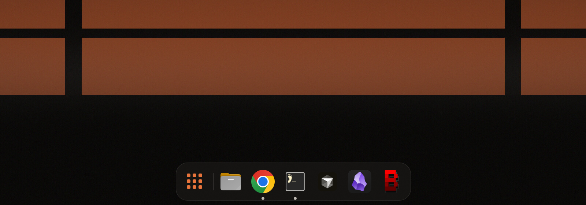

# Glass Dock

A small, pixel-aligned, macOS-style dock for [Omarchy](https://omarchy.org) and Hyprland, built with [Quickshell](https://quickshell.org) (which Omarchy already ships).



- **Sharp on HiDPI.** Icons load at full device resolution. The geometry uses whole logical pixels and the border is a one-physical-pixel hairline at 2×, so nothing gets upscaled or blurred.
- **Follows your Omarchy theme.** Colours come from the active theme and update live when you switch themes.
- **Auto-hides.** It slides up when the pointer reaches the bottom edge and hides again shortly after the pointer leaves.
- **macOS-style touches:** a running-app dot under each icon, the app name above the hovered icon, and a hand-drawn app-grid button that opens Omarchy's Apps menu.
- **Click behaviour:** click opens or focuses an app, clicking again cycles through its windows, and middle-click opens a new window.

## Install

```bash
git clone https://github.com/JeoCrypto/omarchy-glass-dock
cd omarchy-glass-dock
./install.sh
qs -c glass-dock &
```

### Start at login

Add to `~/.config/hypr/autostart.lua`:

```lua
o.launch_on_start("qs -c glass-dock")
```

### Frosted blur (recommended)

Add to `~/.config/hypr/looknfeel.lua`:

```lua
hl.layer_rule({ match = { namespace = "^glass-dock$" }, blur = true, ignore_alpha = 0.2 })
```

## Configure

| File | What it does |
|---|---|
| `~/.config/glass-dock/pinned` | Pinned apps: one desktop-file id per line, e.g. `org.gnome.Nautilus`, `chromium`, `foot`. Changes apply immediately. |
| `~/.config/glass-dock/aliases` | Optional `<app-id> <desktop-id>` pairs, for windows whose app id doesn't match a desktop file (e.g. `my.custom.terminal foot`). |

Sizes (icon size, cell size, gaps, padding, radius) are at the top of `~/.config/quickshell/glass-dock/shell.qml`.

To show or hide the dock from a keybinding or script:

```bash
qs -c glass-dock ipc call dock toggle
```

## Requirements

- Omarchy 4 (Hyprland 0.55+ with Lua config, Quickshell 0.3+)
- `uwsm` and `gtk-launch`, which Omarchy includes

## License

MIT
