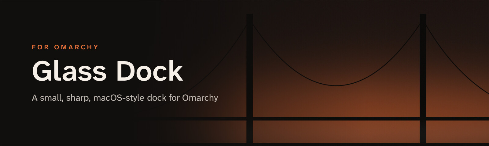
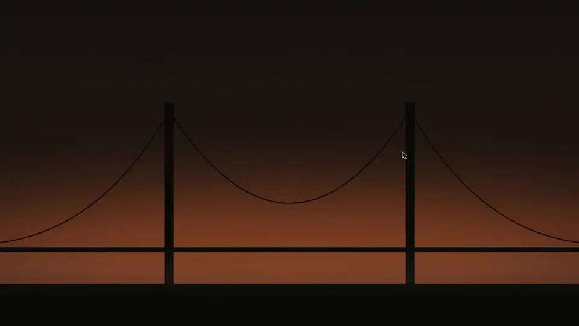

<p align="center">
  
</p>

<p align="center">
  <b>A small, pixel-sharp, macOS-style dock for <a href="https://omarchy.org">Omarchy</a>.</b><br>
  Auto-hides · app names on hover · running-app dots · follows your theme
</p>

<p align="center">
  
  
  
</p>

<p align="center">
  
</p>

## Get started

**1. Install the plugin.** It loads with the Omarchy shell, so there's nothing to add to your autostart.

```bash
omarchy plugin add https://github.com/JeoCrypto/omarchy-glass-dock --enable
```

**2. Frost the glass** (recommended) in `~/.config/hypr/looknfeel.lua`:

```lua
hl.layer_rule({ match = { namespace = "^glass-dock$" }, blur = true, ignore_alpha = 0.2 })
```

## Highlights

<table>
  <tr>
    <td width="50%" valign="top">
      <h3>🔍 Sharp on HiDPI</h3>
      Icons load at full device resolution. The geometry uses whole logical pixels, and the border is a one-physical-pixel hairline at 2×, so nothing gets upscaled or blurred.
    </td>
    <td width="50%" valign="top">
      <h3>🎨 Follows your theme</h3>
      Colours come from the active Omarchy theme and update live when you switch themes.
    </td>
  </tr>
  <tr>
    <td valign="top">
      <h3>🫥 Out of the way</h3>
      It slides up when the pointer reaches the bottom edge and hides again shortly after the pointer leaves.
    </td>
    <td valign="top">
      <h3>🍎 macOS touches</h3>
      A running-app dot under each icon, the app name above the hovered icon, and a hand-drawn app-grid button that opens Omarchy's Apps menu.
    </td>
  </tr>
</table>

**Clicking:** click opens or focuses an app, clicking again cycles through its windows, and middle-click opens a new window.

## Configure

| File | What it does |
|---|---|
| `~/.config/glass-dock/pinned` | Pinned apps: one desktop-file id per line, e.g. `org.gnome.Nautilus`, `chromium`, `foot`. Without this file the dock pins Files, Chromium and Foot. Changes apply immediately. |
| `~/.config/glass-dock/aliases` | Optional `<app-id> <desktop-id>` pairs, for windows whose app id doesn't match a desktop file (e.g. `my.custom.terminal foot`). |
| `~/.config/glass-dock/launcher` | Optional command for the app-grid button (default `omarchy-menu toggle apps`), e.g. `omarchy-shell shell toggle io.github.jeocrypto.launchpad` for [Spotlight Apps](https://github.com/JeoCrypto/omarchy-spotlight-apps). |

Sizes (icon size, cell size, gaps, padding, radius) are at the top of `Dock.qml` (`~/.config/omarchy/plugins/io.github.jeocrypto.glass-dock/Dock.qml` when installed as a plugin).

To show or hide the dock from a keybinding or script:

```bash
omarchy-shell glass-dock toggle                   # plugin
qs -c glass-dock ipc call glass-dock toggle       # standalone
```

## Update and remove

```bash
omarchy plugin update io.github.jeocrypto.glass-dock
omarchy restart shell
```

The dock stays loaded while the shell runs, so restart the shell to pick up a new version.

```bash
omarchy plugin remove io.github.jeocrypto.glass-dock
```

Your pinned-apps and aliases files in `~/.config/glass-dock/` are left in place; delete that folder if you don't want them.

## Run without the plugin system (optional)

Glass Dock can also run as its own Quickshell instance:

```bash
git clone https://github.com/JeoCrypto/omarchy-glass-dock
cd omarchy-glass-dock
./install.sh
qs -c glass-dock &
```

To start it at login, add `o.launch_on_start("qs -c glass-dock")` to `~/.config/hypr/autostart.lua`.

## Requirements

- Omarchy 4 (Hyprland 0.55+ with Lua config, Quickshell 0.3+)
- `uwsm` and `gtk-launch`, which Omarchy includes

---

<p align="center">
  <b>Part of the Golden Gate set for Omarchy</b><br>
  <a href="https://github.com/JeoCrypto/omarchy-golden-gate-theme">Golden Gate theme</a> ·
  <a href="https://github.com/JeoCrypto/omarchy-glass-dock">Glass Dock</a> ·
  <a href="https://github.com/JeoCrypto/omarchy-spotlight-apps">Spotlight Apps</a> ·
  <a href="https://github.com/JeoCrypto/omarchy-snap-layouts">Snap Layouts</a>
</p>

<p align="center"><sub>MIT licence</sub></p>
